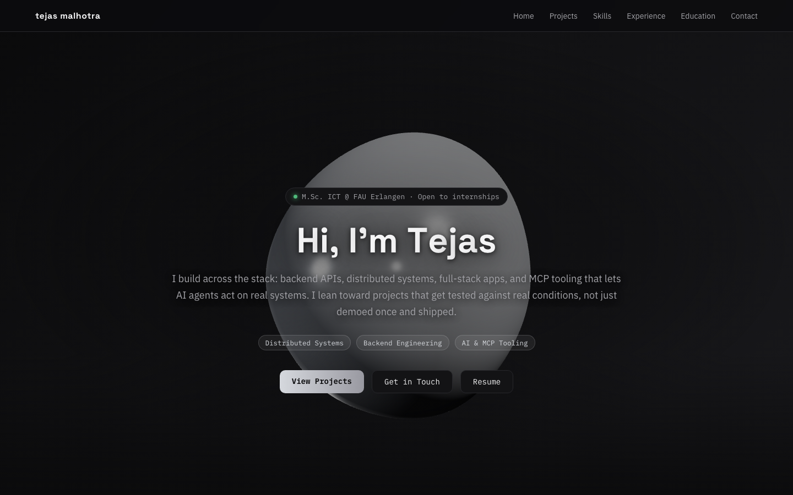

# Tejas Malhotra, Portfolio

A single-page personal portfolio built as a dark, terminal-themed site with a live 3D hero scene. Not a static template: the hero is a real-time WebGL render that reacts to your cursor and scroll position, and every section transitions in with hand-tuned framer-motion animation.



## Structure

The whole site is one scrolling page (`src/App.tsx`) with anchor-linked navigation, not separate routes.

```
Home (hero + 3D orb)
  |
  +-- About        ($ about --me)
  +-- Skills       ($ skills --stack)        5 category cards, 28 listed skills
  +-- Projects     ($ projects --selected)    4 featured projects with GitHub/demo links
  +-- Experience   ($ experience --all)       timeline, 2 roles
  +-- Education    ($ education --history)    timeline, 2 degrees
  +-- Contact      ($ contact --open)         email, GitHub, LinkedIn
```

Section headers use a `$ command --flag` convention (e.g. `$ projects --selected`), carrying the terminal aesthetic (IBM Plex Mono, dark background, muted greys) through every part of the page, not just the hero.

## Built with

| Tech | Role |
| --- | --- |
| React 19 | UI and component structure |
| TypeScript | Type safety across the app |
| Vite | Dev server and build tooling |
| three.js | WebGL rendering engine under the hood |
| @react-three/fiber | React renderer for the three.js scene |
| @react-three/drei | Helpers for the 3D scene (float animation, distort material) |
| framer-motion | Entrance animations and the letter-by-letter title reveal |

## The 3D hero, in detail

`src/HeroOrb.tsx` renders a single `icosahedronGeometry` wrapped in drei's `MeshDistortMaterial`, which perturbs the mesh's vertices with simplex noise every frame to give it that liquid-metal, slowly rippling surface rather than a static polyhedron.

On top of that it is genuinely interactive, not just decorative:

- Pointer-driven rotation: the orb's Y and X rotation track `pointer.x` / `pointer.y` from `useFrame`, so it tilts toward the cursor in real time.
- Scroll-linked camera dolly: as you scroll past the hero, `camera.position.z` and `camera.position.y` are interpolated from `window.scrollY`, pulling the camera back and down so the orb recedes as the page scrolls, instead of just scrolling off screen.
- A gentle idle float (drei's `Float`) layered on top so the orb is never fully still, even without input.
- Three directional lights plus a point light at carefully tuned intensities and cool greys, so the distort material reads as brushed metal instead of flat plastic.
- Responsive device pixel ratio capping (`dpr={isSmall ? [1, 1.2] : [1, 1.6]}`) and `powerPreference: 'low-power'` to keep it smooth on laptops and phones rather than maxing out the GPU.

The rest of the page leans on framer-motion: the hero title animates in character by character with a staggered delay and a slight rotateX "flip up," and every section's badges, tags, and call-to-action buttons fade and slide in on load with a shared custom easing curve.

## Running it locally

```bash
npm install
npm run dev       # starts Vite on localhost, default port 5173
```

Other scripts:

```bash
npm run build      # type-check with tsc, then production build via Vite
npm run preview    # preview the production build locally
npm run lint        # oxlint
```

Requires Node (any recent LTS). No environment variables or backend needed, the site is fully static once built.
